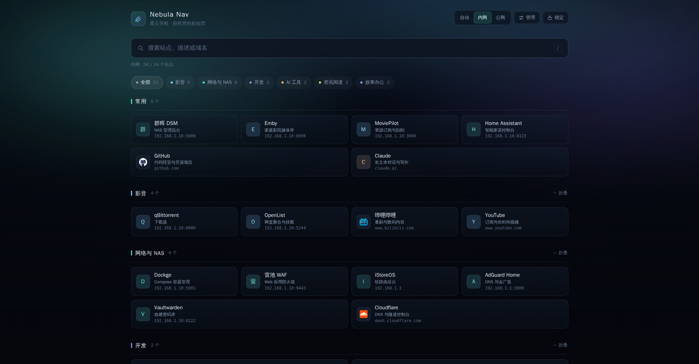
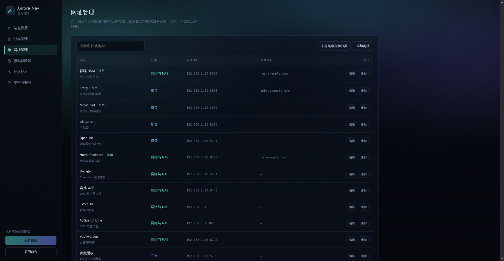

# Aurora Nav · 极光导航

自托管的个人导航页。




前台要访问密码才看得到内容，后台可以维护分类和网址；同一个站点可分别配置内网与公网地址，一键切换；另带一个需要二次验证的密码保险箱。

- **零依赖**：只用 Node 内置模块，不需要 `npm install`，镜像小、启动快
- **单文件存储**：所有配置落在 `data/data.json`，备份就是复制一个文件
- **密码门禁**：前台访问密码 + 独立的后台账号，会话用 HttpOnly Cookie 签名
- **后台管理**：站点、分类、站点设置、导入导出、账号密码
- **内外网切换**：每个站点两套地址，前台按「自动 / 内网 / 公网」选用，只有一套时回退并标注
- **自动分类**：新增网址时按域名关键词猜分类，书签导入也会自动归类
- **书签导入**：直接吃浏览器导出的书签 HTML
- **密码保险箱**：条目列表默认打码，进入需再输一次访问密码，30 分钟自动上锁
- **响应式**：手机、平板、桌面都能用，移动端优先排的版

## 快速开始

### Docker Compose（推荐）

```bash
git clone https://github.com/congyuyang666/aurora-nav-web.git aurora-nav
cd aurora-nav
cp .env.example .env          # 可选：先填好初始密码与会话密钥
docker compose up -d
```

打开 `http://<服务器IP>:8080`，首次进入：

| 位置 | 账号 | 密码 |
| --- | --- | --- |
| 前台 | — | `123456` |
| 后台 `/admin.html` | `admin` | `admin123` |

**装完第一件事**：到后台「安全与账号」把这两个密码改掉。

### 直接跑 Node

```bash
node server.js            # 需要 Node 18+，默认 8080 端口
PORT=9000 DATA_DIR=./data node server.js
```

### 环境变量

| 变量 | 默认 | 说明 |
| --- | --- | --- |
| `PORT` | `8080` | 监听端口 |
| `HOST` | `0.0.0.0` | 监听地址 |
| `DATA_DIR` | `./data` | 数据目录，Docker 中挂到 `/data` |
| `FRONT_PASSWORD` | `123456` | **仅首次初始化**使用的访问密码 |
| `ADMIN_USERNAME` / `ADMIN_PASSWORD` | `admin` / `admin123` | **仅首次初始化**使用的后台账号 |
| `SESSION_SECRET` | 自动生成 | 会话签名密钥；固定后重建容器不会让已登录设备掉线 |
| `COOKIE_SECURE` | `0` | 走 HTTPS 时设为 `1`，Cookie 加 `Secure` |

`data/data.json` 一旦存在，环境变量里的初始密码就不再覆盖它，改密码请走后台。

## 目录结构

```
aurora-nav/
├── server.js                # HTTP 服务：鉴权、配置读写、图标代理
├── seed.json                # 首次启动的示例数据
├── public/
│   ├── index.html           # 前台导航
│   ├── admin.html           # 后台管理
│   └── assets/
│       ├── app.css          # 全站样式（深色极光主题）
│       ├── app.js           # 前台：门禁、筛选、搜索、模式切换
│       ├── admin.js         # 后台：草稿编辑、保存、保险箱、导入导出
│       └── taxonomy.js      # 自动分类规则
├── data/                    # 运行时生成，不要提交到仓库
│   ├── data.json            # 分类 / 站点 / 设置 / 保险箱
│   ├── favicons/            # 抓取到的站点图标缓存
│   └── .secret              # 自动生成的会话密钥
├── Dockerfile
├── docker-compose.yml
└── .env.example
```

## 使用说明

### 站点的两套地址

每个站点有「内网地址」和「公网地址」，只填一个也能用。

- 前台切换 **内网 / 公网**：优先用对应地址，缺哪个就用另一个，并给卡片加 `内网` / `公网` 小标记
- **自动**：按当前访问域名判断。`192.168.x`、`10.x`、`172.16–31.x`、`localhost`、`.local` 视为内网，其余视为公网

### 自动分类

`public/assets/taxonomy.js` 里是一组「分类 → 关键词」规则，按域名和标题匹配。新增网址时在地址框失焦后自动带出分类，分类下拉里默认是「自动判断」。想加自己的规则，直接往对应分类的 `words` 里补词即可。

### 导入书签

后台「导入导出」→ 选择书签 HTML（Chrome / Edge 导出的 `bookmarks_*.html`）：

- 只导 `http(s)` 链接，同一域名会自动去重
- 书签文件夹名能对上现有分类就归进去，否则按网址关键词猜
- 最多一次导入 400 个，导入后记得点「保存修改」

### 图标

卡片图标默认走服务器代理：`/api/favicon?host=xxx`，抓 `https://host/favicon.ico`，成功后在 `data/favicons/` 缓存 7 天。内网设备会改走 `http://`。

抓不到就退回首字母色块；纯黑单色的图标（比如 GitHub）会自动反相，避免在深色卡片上看不见。也可以给单个站点填「图标地址」覆盖。

### 备份与恢复

```bash
# 备份
cp data/data.json ~/aurora-nav-$(date +%F).json

# 恢复
cp ~/aurora-nav-2026-11-11.json data/data.json && docker compose restart
```

后台的「导出 JSON」只含分类、站点和站点设置，不含密码与保险箱内容。

## 安全说明

- 密码用 `scrypt` 加盐哈希存在 `data.json`，不存明文
- 会话是 HMAC-SHA256 签名的 HttpOnly Cookie，前台 7 天、后台 8 小时、保险箱 30 分钟
- 登录失败按 IP 限流：10 分钟内错 8 次锁 10 分钟
- 所有配置接口都要有效会话；`data.json` 以 `0600` 权限写入
- 所有站点地址只接受 `http://` / `https://`，其它协议会被丢弃
- **保险箱里的账号密码是本机明文存储的**，只靠「进页面要再输一次访问密码」保护，不是加密密码管理器。最关键的密码请别放进来；整机磁盘加密、目录权限和 HTTPS 仍然要做
- 暴露到公网时务必套 HTTPS 反代（Nginx / Caddy / Cloudflare Tunnel 均可），并设置 `COOKIE_SECURE=1`

## 常见问题

**忘记后台密码了？**
停掉服务，把 `data/data.json` 备份后删掉，重启会用环境变量里的初始账号重新初始化——分类和站点也会一起清空。只想重置密码的话，用导出的 JSON 重新导入站点配置。

**图标一直转不出来？**
服务器访问不到目标站点的 `/favicon.ico`（内网设备关机、站点拦截、出网受限都会这样）。给该站点填一个「图标地址」，或让它退回首字母色块。

**Docker 里改了 `data.json` 没生效？**
容器内路径是 `/data/data.json`，宿主机对应 `./data/data.json`。确认改的是挂载出来的那份。

**要不要数据库？**
不需要。单文件存储适合个人导航这种数据量，读取全量、写入原子替换。注意只适合单实例运行，不要开多副本。

## 接口

| 方法 | 路径 | 说明 |
| --- | --- | --- |
| POST | `/api/auth/login` | 前台访问密码登录 |
| POST | `/api/auth/logout` | 退出 |
| GET | `/api/auth/status` | 当前会话角色 |
| GET | `/api/config` | 分类 + 站点 + 站点设置（需会话） |
| POST | `/api/vault/unlock` | 用访问密码换取保险箱令牌 |
| PUT | `/api/vault` | 保存保险箱条目（需保险箱令牌） |
| POST | `/api/admin/login` | 后台登录 |
| GET/PUT | `/api/admin/data` | 读取 / 保存分类、站点与设置 |
| POST | `/api/admin/password` | 修改前台或后台密码 |
| GET | `/api/favicon?host=` | 站点图标代理（需会话） |
| GET | `/api/health` | 健康检查 |

## License

MIT
